**Team.** Thijil Thejaswi MN (PES1UG24AM412, M1, data & features, report assembly) · Sunidhi Shekhar (PES1UG24AM410, M2, models, metrics, Bayesian optimisation) · Tasya Shetty (PES1UG24AM411, M3, HMM / Viterbi design) · Uthkarsha (PES1UG24AM413, M4, API, UI, deployment).
**Repository.** <https://github.com/Thijil-Thejaswi-MN/ML-Hackathon> — every number, table and figure below is produced by code in this repository; the file that holds each result is cited next to it.

**Partitions.** *train* = 80 trips (all model fitting, cross-validation, threshold and decoder tuning, Bayesian optimisation). *student_test* = 10 trips (evaluated once per final configuration, never used to choose anything). The evaluator partition was not available to us during development.

---

## 1. Problem and pipeline in one paragraph

Each trip gives a 1 Hz GPS track, the trip's own road network (nodes + directed arcs) and, offline only, the ordered list of arcs the vehicle drove (`.route`). We must assign **one road arc to every GPS observation** and return a connected route. Our pipeline is: per-trip metric projection → per-observation reference labels (offline) → candidate arcs per observation (spatial index) → 37 features per (observation, candidate) → a binary classifier "is this candidate the true arc?" → HMM/Viterbi over the candidates with road-network transitions → shortest-path stitching into a route → FastAPI service on laptop 1, Streamlit UI on laptop 2.

---

## 2. Dataset understanding and exploratory data analysis

### 2.1 What the data is

| | train | student_test |
|---|---|---|
| trips | 80 | 10 |
| GPS observations | 208,417 (361–19,313 per trip, median 1,529) | 19,160 (262–3,958, median 1,420) |
| road arcs per trip | 649–307,392 (median 19,527) | 3,577–56,027 |
| reference-route arcs per trip | 59–2,266 (median 280) | 95–1,323 |

Source: `results/eda/inventory.csv`, produced by `scripts/00_inventory.py`. Trips come from cities all over the world (longitude −100…137, latitude −35…62) and **each trip has its own road network**, so there is no shared coordinate system or shared graph.

### 2.2 How we pre-processed the data (Q1)

1. **Loading and validation** (`src/pathsnap/io.py`, `scripts/00_inventory.py`). All four files exist for all 90 trips; column order and value ranges were checked per trip.
2. **Metric projection** (`src/pathsnap/geo.py`). Distances in degrees are meaningless (a degree of longitude shrinks with latitude), so every trip is projected to local metres with an equirectangular projection centred on the trip's median GPS position, scaled by the WGS84 radii of curvature at that latitude. Check: consecutive-fix distances agree with haversine to ≤ 1.3 m on every trip (`proj_check_max_abs_err_m` in the inventory) — far below GPS noise.
3. **Per-observation labels** (`src/pathsnap/labels.py`). The `.route` lists ~280 arcs for ~2,600 fixes, so labels are not given per point. We align fixes to the route with a **monotone dynamic programme**: fix *i* gets route position *j<sub>i</sub>* with *j* non-decreasing in time; cost = point-to-arc distance + a heading-disagreement term (only when moving > 2 m/s) + a small penalty for advancing and for skipping route length. Monotonicity matters because routes revisit places (loops, U-turns, both directions of a street); the naive "nearest route arc" disagrees with the DP on a median 5 % (up to 45 %) of fixes per trip (`results/data/trip_stats_train.csv`).
4. **Label reliability.** For trips **33 and 54** the GPS lies a median **122 m and 140 m** from the reference route for the whole trip (figure 2.3) — a systematic offset of GPS or route. We flag fixes whose label is > 50 m away as unreliable (`label_reliable`): 88.8 % of train and 99.9 % of student_test fixes are reliable. **Classifiers are trained on reliable fixes only**; metrics are reported on all fixes (main number) and on reliable fixes.
5. **Candidate generation** (`src/pathsnap/candidates.py`). Arcs are densified every 10 m into a KD-tree, so no arc within the radius can be missed. Radius is adaptive (50 → 100 → 200 m, widened only where fewer than 3 candidates are found); the nearest K arcs are kept. K and the radius schedule were chosen from a sweep on train (`scripts/02a_candidate_sweep.py`, `results/data/candidate_sweep.csv`): at K = 12 the miss rate was 0.57 % and every miss sat at a dense junction with ≥ 12 arcs within 50 m; **K = 30** cuts it to 0.03 % for only 2.5 more candidates per fix on average (10.4). Final: 11.6 candidates per fix; candidate miss rate 0.03 % (train, reliable) and **0.10 % (student_test)** (`results/data/build_log.json`).
6. **Nothing was imputed or deleted.** No NaNs exist; stops (duplicate positions) and GPS jumps were kept and handled by features (speed clipped at 80 m/s, gaps at 3,600 s).

### 2.3 Missing-value and data-quality analysis

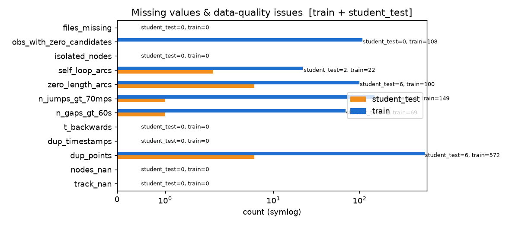{width=88%}

| Issue (train / student_test) | Count | Decision |
|---|---|---|
| NaN in track / nodes | 0 / 0 | nothing to impute |
| duplicated GPS positions | 572 / 6 | kept (real stops); `stationary`, `head_valid` features |
| backwards or duplicate timestamps | 0 / 0 | — |
| time gaps > 60 s | 69 / 1 (max 153,064 s in train trip 90) | `dt_prev`, `dt_next` features; HMM breaks the chain at gaps |
| implied speed > 70 m/s | 149 / 1 steps | glitches kept, speed clipped |
| fixes with zero candidates | 108 / 0 | kept; HMM inherits the nearest decoded arc |

Sampling is nominally 1 Hz (median trip: 99.1 % of train steps are exactly 1 s, figure below), but some trips are irregular and contain long gaps.

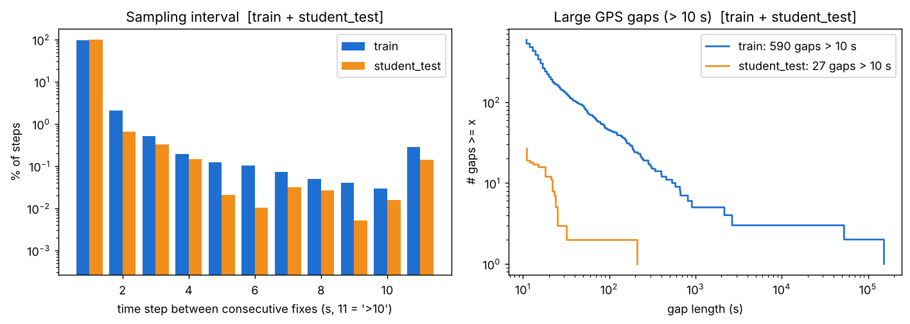{width=88%}

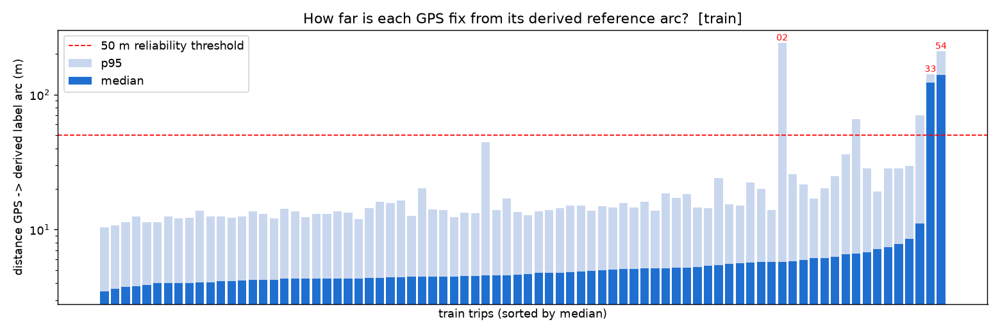{width=95%}

### 2.4 GPS trajectories and road-network visualisation

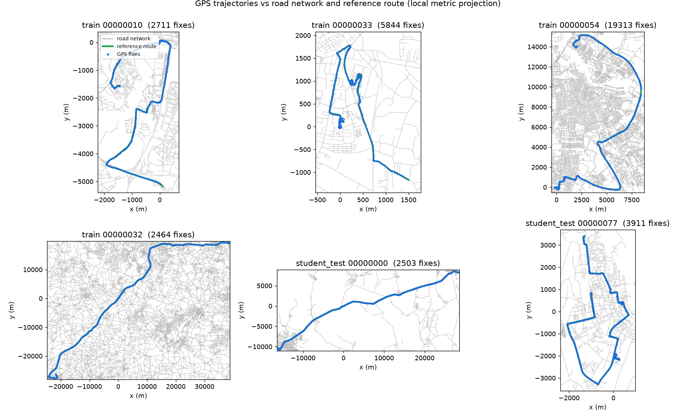{width=100%}

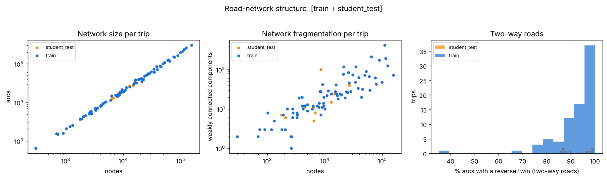{width=100%}

### 2.5 Patterns we observed (Q2) and the features they led to

* **Two-way streets are two directed arcs with identical geometry** (median 95 % of arcs have a reverse twin). Distance cannot separate them; only the direction of travel can → heading features. Picking the *nearest* arc is right only **49.2 %** (train) / **53.2 %** (student_test) of the time (`build_log.json`), largely because of these twins and of parallel roads.
* **GPS error is a few metres** (median fix-to-label distance 3.5–11 m on 78 of 80 trips) but bursts of larger error occur → relative-distance and neighbour-window features rather than raw distance alone.
* **Neighbouring fixes are strongly correlated** — the vehicle stays on an arc for several seconds → features describing whether the previous / next fixes also lie on the arc, and whether the arc connects to their best candidates.
* **Networks are fragmented** (up to 421 weak components, median 20) and the reference route is not always perfectly connected (98.1–100 % of consecutive route arcs share a node) → the decoder must allow unreachable transitions instead of failing.
* **Speeds range from stops to highways** (median ≈ 41 m/s on trips 1 and 32) → speed / time-gap features, and heading only trusted when moving.

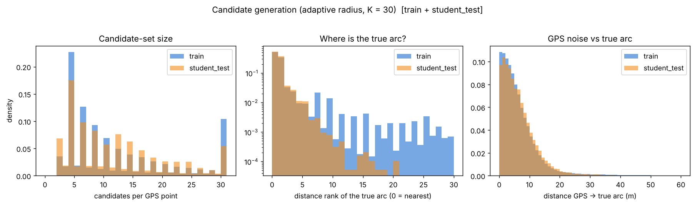{width=100%}

**Features (37 per observation–candidate pair; `src/pathsnap/features.py`, order frozen in `artifacts/features.json`).** The same function runs offline and inside the API, so there is no train/serve skew.

| Group | Features | Why |
|---|---|---|
| geometry (10) | distance, distance rank, distance − best, distance / best, distance − best other, projection fraction, distance to arc end, signed lateral offset, arc length, search radius used | how close, absolutely and relative to the alternatives |
| direction (5) | cos and absolute difference of vehicle heading vs arc bearing (±5 fixes), heading-valid flag, short (±1) and long (±15) heading | the only signal that separates an arc from its reverse twin |
| window (5) | mean / max distance of the ±2 and ±5 neighbouring fixes to this arc, share of neighbours projecting inside the arc | smooths single-fix noise |
| kinematics (5) | speed, acceleration, time to previous / next fix, stationary flag | heading unreliable when stopped; distances unreliable after gaps |
| context (6) | candidate count, has-twin, is-twin-of-nearest, node degrees | junction density, twin ambiguity |
| continuity (6) | same as / linked to the previous and next fix's top-3 candidates; distance to their nearest arcs | sequence hint for a pointwise classifier |

### 2.6 Folium map of the raw data

The interactive maps `maps/eda_train_00000010.html`, `maps/eda_train_00000033.html` and `maps/eda_student_test_00000000.html` are produced by `scripts/01_eda.py` with `src/pathsnap/viz/folium_maps.py` (layers: raw GPS, road network near the trip, reference route; legend; layer control).

{width=100%}

---

## 3. Model experimentation and comparison

**Common protocol (identical for every model; `src/pathsnap/training.py`, run by `scripts/03_train_model.py`).** Task: binary classification of candidate rows (label 1 = the candidate is the observation's reference arc; 8.2 % positives). Inputs: the 37 features standardised with `artifacts/scaler.joblib` (fit on train only; the API applies the same scaler). Training rows: reliable train observations (1,934,576 candidate rows). Cross-validation: **5 frozen group folds by trip** (`data/processed/folds.json`; whole trips per fold, balanced by observation count), so no trip is ever in both training and validation. **Top-1** = share of observations whose highest-probability candidate is the reference arc (misses count as wrong; threshold-free). **Macro F1** = mean of the F1 of class 1 and class 0 over candidate rows at threshold τ, where τ maximises macro F1 on train out-of-fold (OOF) probabilities. Route continuity = share of consecutive distinct predicted arcs that connect head-to-tail (classifier-only, before HMM). Inference time = feature matrix → probabilities on the 220,054 student-test candidate rows, per 1000 observations. All runs: seed 42; versions in each `results/models/<model>/config.yaml` (Python 3.12.4, scikit-learn 1.9.1, LightGBM 4.7.0; the MLP was run on M1's laptop with Python 3.11.9 and PyTorch 2.15.0 CPU).

### 3.1 Overall model comparison

Source: `results/model_comparison.csv` (`scripts/04_compare_models.py`). Top-1, route continuity, macro F1 and log loss are on **student_test**; CV macro F1 is mean ± std over the 5 train folds.

| Model | Algorithm family | Key configuration | CV Macro F1 | Top-1 Accuracy | Route continuity | Student-Test Macro F1 | Log Loss | Inference Time (ms / 1000 obs) |
|---|---|---|---|---|---|---|---|---|
| Logistic Regression | Linear | C = 1, L2, lbfgs | 0.9252 ± 0.0156 | 0.8801 | 0.768 | 0.9255 | 0.0629 | 1.9 |
| KNN | Instance-based | k = 25, distance-weighted, 60k stored rows | 0.9132 ± 0.0162 | 0.8553 | 0.742 | 0.9113 | 0.0900 | 919.7 |
| Random Forest | Bagging ensemble | 100 trees, depth 12, balanced_subsample | 0.9406 ± 0.0156 | 0.8868 | 0.787 | 0.9367 | 0.0779 | 54.3 |
| Extra-Trees | Randomised tree ensemble | 200 trees, depth 18, leaf 5, √features | 0.9404 ± 0.0156 | 0.8949 | 0.808 | 0.9389 | 0.0501 | 56.9 |
| MLP | Neural network | 64-32 ReLU, BatchNorm, dropout 0.1, Adam, 15 epochs | 0.9380 ± 0.0152 | 0.8961 | 0.812 | 0.9362 | 0.0622 | 2.6 |
| LightGBM (untuned) | Gradient boosting | 400 trees, lr 0.05, 63 leaves | 0.9445 ± 0.0151 | 0.9014 | 0.799 | 0.9423 | 0.0434 | 40.7 |
| **LightGBM (tuned, final)** | Gradient boosting | 900 trees, lr 0.039, 80 leaves (§4) | **0.9453 ± 0.0151** | **0.9073** | 0.802 | **0.9441** | **0.0423** | 117.5 |

*Route continuity here is classifier-only by design; HMM continuity is reported in §5.*

**Selection.** Primary criterion CV Top-1, then CV macro F1, then log loss (the HMM consumes probabilities) and inference time (live demo). LightGBM leads on CV Top-1 (0.9058 vs 0.8967 for both forests and 0.8957 for the MLP; `docs/DECISIONS.md`), CV macro F1 and log loss, and is small (1.3 MB) and fast, so it was taken forward to Bayesian optimisation (§4); the tuned model is the deployed one (`artifacts/manifest.json`).

### 3.2 Per-model questions

#### 3.2.1 Logistic Regression (`src/pathsnap/models/logreg.py`)
**A. Why / strengths / limitations.** A linear model over standardised features is the natural baseline: it outputs a real probability (a sigmoid of a weighted sum), exactly what the HMM emission needs, it trains in seconds on 1.9 M rows and its coefficients are readable. Its limitation for PathSnap is that the evidence interacts — distance only matters when the heading agrees, heading only matters when the vehicle moves — and a linear score cannot express "only when"; it relies entirely on the hand-made relative features.
**B. Hyperparameters / objective.** C = 1.0 (L2 strength 1/C), lbfgs, max_iter = 300, natural class weights. Objective: L2-regularised binary cross-entropy (log loss).
**C. Results.** Student_test Top-1 **0.8801**, macro F1 **0.9255**, log loss **0.0629** (τ = 0.49); precision 0.867, recall 0.861. **Fit:** train in-sample Top-1 0.8954, CV 0.8857, test 0.8801 — the smallest gap of all models (≈ 1 point), and train and test log loss are similar (0.0616 vs 0.0629): **no overfitting; mild underfitting** — it is 2–3 points below the tree models on every partition, consistent with its inability to model feature interactions.

#### 3.2.2 K-Nearest Neighbours (`src/pathsnap/models/knn.py`)
**A. Why / strengths / limitations.** "Candidates that looked like this were usually the true arc" — a non-parametric contrast with no assumption on the boundary. In our runs its limitations dominated: every prediction compares against all stored rows, so we stored a seeded, class-stratified 60,000-row sample (3 % of the training rows); all 37 features weigh equally in the Euclidean distance, including weak ones; and vote-fraction probabilities are coarse.
**B. Hyperparameters / objective.** k = 25, distance weighting, Euclidean distance on standardised features, max_train_rows = 60,000. There is no optimisation objective — training only stores the sample; prediction is a distance-weighted vote.
**C. Results.** Student_test Top-1 **0.8553**, macro F1 **0.9113**, log loss **0.0900** — lowest of all models — and by far the slowest (**919.7 ms / 1000 obs**, ~480× logistic regression). **Fit:** train 0.8784 vs CV 0.8608 vs test 0.8553 — small gap, so not overfitting; it **underfits** because only 3 % of the data is stored and distances are dominated by uninformative dimensions.

#### 3.2.3 Random Forest (`src/pathsnap/models/rf.py`)
**A. Why / strengths / limitations.** Trees learn the threshold interactions above directly and need no scaling; bagging many deep trees reduces variance. Limitations seen in our results: probabilities are vote fractions and, with `balanced_subsample` class weighting, systematically inflated for the positive class — hence the highest chosen threshold of all models (τ = 0.81) and a weaker log loss (0.0779) than Extra-Trees despite similar accuracy; 258 s to fit and 13.9 MB on disk.
**B. Hyperparameters / objective.** 100 trees, max_depth 12, min_samples_split 5, min_samples_leaf 2, class_weight = balanced_subsample, bootstrap. Each split minimises Gini impurity.
**C. Results.** Student_test Top-1 **0.8868**, macro F1 **0.9367**, log loss **0.0779**; recall 0.897 (highest), precision 0.873. **Fit:** train 0.9192 vs CV 0.8967 vs test 0.8868 — a 2–3 point generalisation gap: **mild overfitting**, limited by the depth cap.

#### 3.2.4 Extra-Trees (`src/pathsnap/models/trees.py`)
**A. Why / strengths / limitations.** Like the forest, but split thresholds are drawn at random, which lowers variance further and trains comparably fast on this data. In our runs this gave the best-calibrated tree ensemble (log loss 0.0501 vs 0.0779 for RF) and the best classifier-only route continuity (0.808). Limitations: deep, unpruned trees make the model large (97.8 MB — too large to commit, so `model.joblib` is excluded and the model is re-created by the training script); probabilities are still vote fractions.
**B. Hyperparameters / objective.** 200 trees, max_depth 18, min_samples_leaf 5, max_features = √37, no bootstrap, natural class weights. Gini impurity with random thresholds.
**C. Results.** Student_test Top-1 **0.8949**, macro F1 **0.9389**, log loss **0.0501** (τ = 0.43). **Fit:** train 0.9231 vs CV 0.8967 vs test 0.8949 — **mild overfitting** (≈ 2.8 points train→CV), similar to the forest; CV and test agree closely, so CV is a trustworthy estimate.

#### 3.2.5 LightGBM (`src/pathsnap/models/boosting.py`) — selected
**A. Why / strengths / limitations.** Gradient boosting adds trees one at a time, each fitted to the current errors; on tabular features with interactions it is typically the strongest learner, and it directly minimises log loss, which gives the HMM well-calibrated emissions. In our runs it was best on CV Top-1, CV macro F1, test Top-1 and log loss, trained in 30 s and is 1.3 MB. Limitations: many interacting hyperparameters (learning rate vs number of trees vs leaves) and it can over-fit with many leaves / iterations (see below).
**B. Hyperparameters / objective.** Untuned: 400 trees, learning_rate 0.05, num_leaves 63, min_child_samples 50, subsample 0.8, colsample_bytree 0.8, reg_lambda 1. Objective: binary log loss.
**C. Results.** Untuned student_test Top-1 **0.9014**, macro F1 **0.9423**, log loss **0.0434**; tuned **0.9073 / 0.9441 / 0.0423**. **Fit:** train 0.9450 vs CV 0.9058 vs test 0.9014 (untuned) — the largest train/CV gap of all models (≈ 4 points), i.e. it fits the training trips most closely. The real training history (fold 0, figure 3.3e) shows the same: validation log loss reaches its minimum **0.0619 at iteration 227** and drifts up to 0.0625 by iteration 400 while training loss keeps falling (0.0299 → 0.0253) — **mild overfitting of the probabilities after ~200–230 trees**; Top-1 is unaffected because the ranking of candidates is stable.

#### 3.2.6 Multi-Layer Perceptron (`src/pathsnap/models/mlp.py`)
**A. Why / strengths / limitations.** A small feed-forward network learns non-linear combinations of the 37 standardised features — the "only when" interactions that a linear model cannot express — and inference is just two small matrix products, so it is the smallest model (0.02 MB) and the second fastest (2.6 ms / 1000 obs). It is also the only model trained by mini-batch gradient descent, so it has a real per-epoch learning curve. Limitations seen in our runs: training is the slowest of all models on CPU (≈ 9 min per fold, 614 s for the full fit vs 30 s for LightGBM); the result depends on the seed and mini-batch order; and the positive-class weight in the loss pushes probabilities up, so its chosen threshold is high (τ = 0.79) and its log loss (0.0622) is worse than LightGBM's and Extra-Trees'.
**B. Hyperparameters / objective.** Two hidden layers of 64 and 32 units, each Linear → BatchNorm → ReLU → dropout 0.1; Adam with learning rate 0.001 and weight decay 10^−4^ (L2); batch size 512; 15 epochs, no early stopping; seed 42. Objective: binary cross-entropy with positive-class weight 4 (`pos_weight`, chosen by M4 to offset the 8.2 % positives). Every log loss we report for the MLP is the ordinary, unweighted log loss.
**C. Results.** Student_test Top-1 **0.8961**, macro F1 **0.9362**, log loss **0.0622** (τ = 0.79); precision 0.906 (the highest of the untuned models), recall 0.862; classifier-only route continuity **0.812**, the highest of all six classifiers. Its CV Top-1 (0.8957 ± 0.029) is level with the two forests and one point below LightGBM, so it was not selected. **Fit:** train 0.9140 vs CV 0.8957 vs test 0.8961 — a ≈ 1.8-point train→CV gap, between logistic regression and the forests: **mild overfitting**. The real training history (fold 0, figure 3.3f) agrees: training log loss falls from 0.066 to 0.054 over 15 epochs, while validation log loss is noisy (0.083–0.095) with no downward or upward trend after epoch 3 (best 0.0825 at epoch 10, 0.0851 at epoch 15). The network stops gaining on unseen trips after a few epochs but does not drift into stronger overfitting; the steady gap reflects the difference between seen and unseen trips (fold 0 is the hardest fold for every model).

### 3.3 Model visualisations

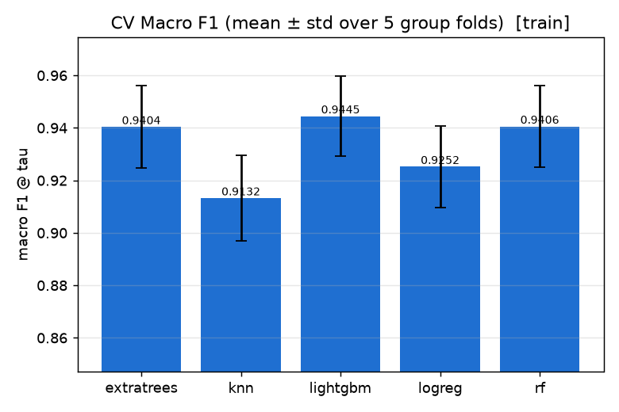{width=85%}

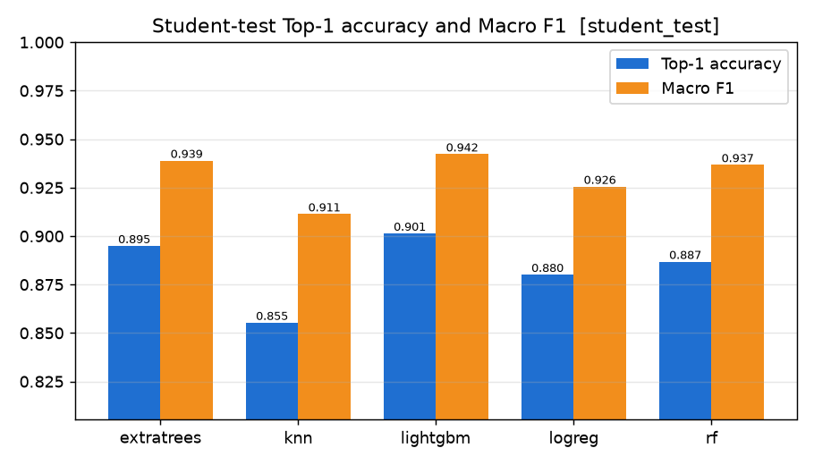{width=85%}

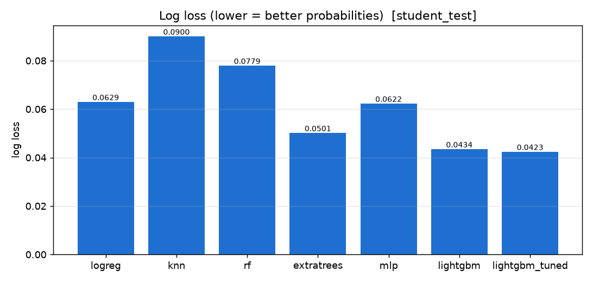{width=75%}

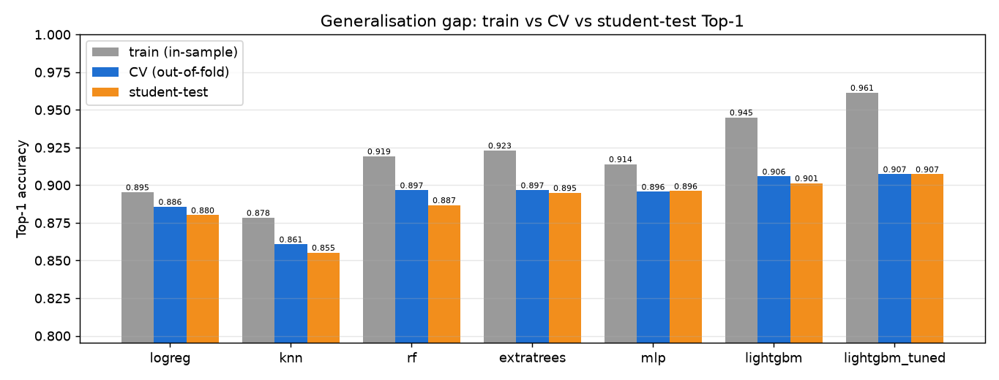{width=85%}

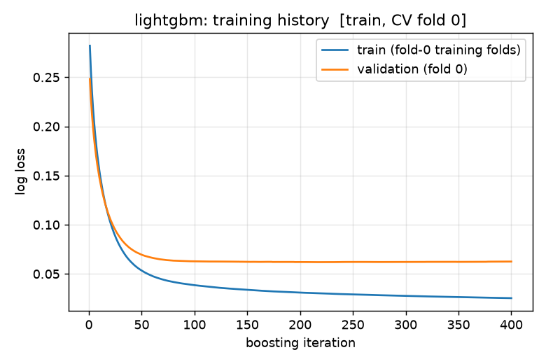{width=65%}

{width=65%}

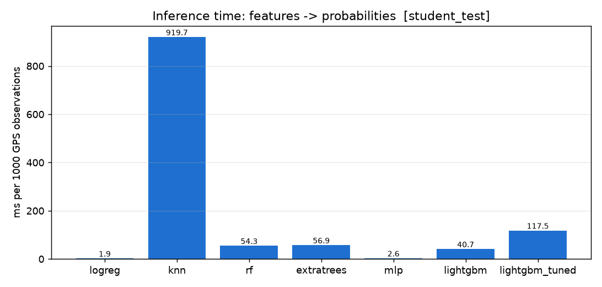{width=75%}

Confusion matrices for every model (student_test candidate rows at each model's τ) are in `results/models/<model>/confusion_matrix.png`; e.g. tuned LightGBM: TN 198,913 · FP 1,795 · FN 2,086 · TP 17,047.

---

## 4. Bayesian hyperparameter optimisation (LightGBM)

Code: `scripts/05_bayes_opt.py`; search configuration: `configs/bo.yaml`; full record: `results/bo/lightgbm/` (`study.db` Optuna storage, `trials.csv`, `best_params.json`, `tuned_vs_untuned.csv`).

1. **Hyperparameters searched:** learning_rate, n_estimators, num_leaves, min_child_samples, subsample, colsample_bytree, reg_lambda, reg_alpha.
2. **Ranges / distributions** (written before running, with a reason each):

| Hyperparameter | Range | Scale | Reason |
|---|---|---|---|
| learning_rate | 0.01 – 0.3 | log | useful values span 30× |
| n_estimators | 100 – 1200, step 50 | linear | small learning rates need more trees |
| num_leaves | 15 – 255 | log | main capacity knob of leaf-wise trees |
| min_child_samples | 10 – 400 | log | minimum rows per leaf; regularises noisy labels |
| subsample | 0.5 – 1.0 | linear | row bagging reduces variance |
| colsample_bytree | 0.4 – 1.0 | linear | 37 correlated features |
| reg_lambda | 0.001 – 10 | log | L2 on leaf values |
| reg_alpha | 0.001 – 5 | log | L1 on leaf values |

3. **Objective:** maximise mean observation-level Top-1 over the 5 frozen group folds (reliable train observations). Sampler: Optuna TPE (seed 42, 10 random start-up trials); median pruner on the running fold mean; trial 0 = the untuned configuration. To fit 40 trials into the event, each trial fitted on a seeded 30 % of training observations (validation folds complete); the final models — tuned and untuned — were both refit on 100 %.
4. **Trials:** 40 (15 completed, 25 pruned), 3,817 s wall-clock.
5. **Best values (trial 20, CV Top-1 0.9066):** n_estimators 900, learning_rate 0.0393, num_leaves 80, min_child_samples 12, subsample 0.775, colsample_bytree 0.673, reg_alpha 1.596, reg_lambda 0.0385.
6. **Did tuning help?** Yes, slightly and consistently, at a cost in speed:

| Same protocol, same partitions | Untuned | Tuned |
|---|---|---|
| CV macro F1 (train, 5 folds) | 0.9445 ± 0.0151 | **0.9453 ± 0.0151** |
| CV Top-1 (train) | 0.9058 | **0.9074** |
| Student-test Top-1 | 0.9014 | **0.9073** |
| Student-test macro F1 | 0.9423 | **0.9441** |
| Log loss (student_test) | 0.0434 | **0.0423** |
| Inference time (ms / 1000 obs) | **40.7** | 117.5 |

We kept the tuned model because it is better on the optimisation objective and on every cross-validation metric (CV Top-1, macro F1); the gain (+0.16 points) is, however, far smaller than the fold-to-fold spread (std 0.028), so it is a marginal improvement. The student-test comparison, made only after this choice, agrees (+0.6 points Top-1, lower log loss). The price is 2.9× slower inference (900 vs 400 trees) — 117 ms per 1000 fixes is still negligible for the live demo. The tuned model also shows the same probability-overfitting pattern as §3.2.5 (validation log loss minimum 0.0613 at iteration 214, 0.0630 at 900), so an early-stopping round count would be the natural next experiment.

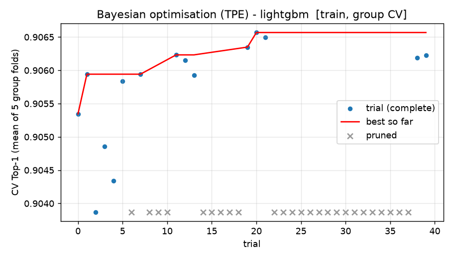{width=75%}

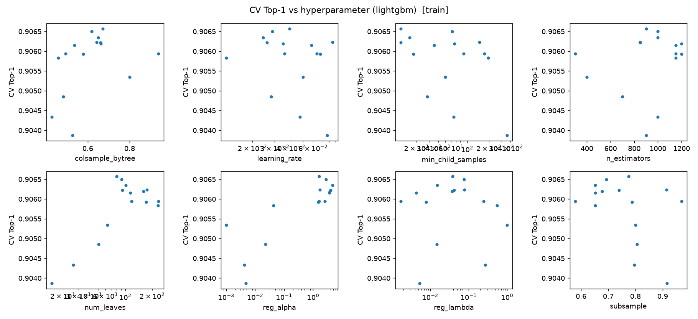{width=100%}

---

## 5. HMM and Viterbi route reconstruction

Code: `src/pathsnap/decoding/hmm.py` (decoder), `src/pathsnap/decoding/route.py` (stitching); tuning / evaluation / maps: `scripts/06_tune_decoder.py`, `07_eval_hmm.py`, `08_make_maps.py`. The model was designed by M3 (`notebooks/pathsnap_m3_hmm_route_matching.ipynb`); the repository version computes it efficiently on our graph structures.

1. **Hidden states.** For each GPS observation, its candidate arcs (≈ 11.6 on average). The decoded state sequence is one arc per observation.
2. **Emission probabilities.** The classifier probability *p* of the candidate, optionally combined with a Gaussian GPS-distance term: log e = log p − λ·d² / (2σ²), normalised over the observation's candidates (σ = 20 m; λ tuned, below).
3. **Transition probabilities.** Following Newson & Krumm: compare the along-network distance between the two positions with the straight-line GPS displacement, log T = −|d<sub>network</sub> − d<sub>GPS</sub>| / β. d<sub>network</sub> = remaining length of arc *a* + shortest path from *a*'s end node to *b*'s start node + covered length of arc *b* (or the along-arc distance when *a* = *b*). Shortest paths are bounded Dijkstra searches on the directed road graph, computed **once per trip** for all candidate end-nodes and stored in a lookup table, so each Viterbi step is a vectorised K × K operation (0.05–1.05 s per student-test trip on the team laptop). Moving backwards along the same directed arc costs an extra penalty (5).
4. **Missing candidates and large gaps.** Observations without candidates, or a time gap > 30 s, end the current chain; each chain is decoded separately and reported as a break. Fixes without candidates take the arc of the nearest decoded fix and are marked unmatched.
5. **Disconnected segments.** A transition whose network path is longer than v<sub>max</sub>·Δt + slack (40 m/s, 100 m) is unreachable and gets log ε (ε = 10⁻⁶) instead of −∞, so Viterbi can still cross a genuine gap in the network rather than fail. After decoding, consecutive decoded arcs that do not connect are joined by the shortest network path (≤ 3 km); joins that do not exist are left as gaps and counted.
6. **Did the HMM help?** Decoder parameters were tuned on **train out-of-fold probabilities** of the final model (grid β ∈ {0.5, 1, 2, 5, 10, 20, 50} m × λ ∈ {0, 1}; `results/hmm/decoder_tuning.csv`), and student_test was decoded once with the chosen configuration (`results/hmm/comparison.csv`):

**Decoder tuning (train, out-of-fold probabilities of tuned LightGBM, reliable fixes; `results/hmm/decoder_tuning.csv`).** Classifier-only Top-1 on the same fixes is 0.9106.

| β (m) | 0.5 | 1 | **2** | 5 | 10 | 20 | 50 |
|---|---|---|---|---|---|---|---|
| HMM Top-1, λ = 0 | 0.8861 | 0.9102 | 0.9145 | 0.9106 | 0.9060 | 0.8991 | 0.8901 |
| HMM Top-1, λ = 1 | 0.8895 | 0.9107 | **0.9147** | 0.9110 | 0.9062 | 0.9000 | 0.8909 |

The optimum β = 2 m lies inside the grid; the GPS-distance emission term adds little (+0.0002–0.0034). Both extremes hurt: with a very small β any mismatch between network and GPS distance is punished so hard that the decoder overrides correct classifier choices; with a large β transitions barely matter and the HMM loses its smoothing (β = 50 m is 2 points *below* classifier-only). Chosen: β = 2 m, λ = 1 (`artifacts/hmm_config.json`, loaded by the API).

**Classifier-only vs classifier + HMM (student_test, decoded once; `results/hmm/comparison_summary.json`).**

| student_test (10 trips) | Classifier only | Classifier + HMM |
|---|---|---|
| Top-1 accuracy (all fixes) | 0.9073 | **0.9140** |
| Top-1 accuracy (reliable fixes) | 0.9086 | **0.9153** |
| Route continuity (raw decoded sequence) | 0.802 | **0.889** |
| Route continuity after shortest-path stitching | — | **1.000** (0.9987 on trip 56) |
| Arc-set F1 of the route vs the reference route | 0.891 | **0.965** |
| Decode time | — | 253 ms per 1000 fixes (0.05–1.05 s per trip) |

**Yes, HMM decoding improved the route**: +0.67 points Top-1, and above all a far more coherent route (continuity +8.7 points; arc-set F1 +7.4 points, because isolated wrong arcs — mostly reverse twins and short side streets — are removed). Per trip (figure 5.1) it improved **7 of 10 trips** (largest gains: trip 07 0.965 → 0.993, trip 76 0.911 → 0.935), left trip 52 unchanged and **made two trips slightly worse**: trip 40 (0.945 → 0.937) and trip 77 (0.828 → 0.823).

**Where it did not help** (`results/hmm/failure_cases.csv`). The longest wrong stretches are places where the *classifier was already wrong*: trip 77, fixes 2312–2563 (252 fixes; classifier correct on only 21 % of them) and trip 40, fixes 0–75 (classifier 25 %). When the emission evidence consistently favours a parallel road, a connected path along that wrong road is perfectly plausible to the transition model, so Viterbi follows it with confidence — and can pull a few neighbouring correct fixes onto it, which explains the small losses on trips 40 and 77. The HMM repairs isolated errors; it cannot repair systematic ones.

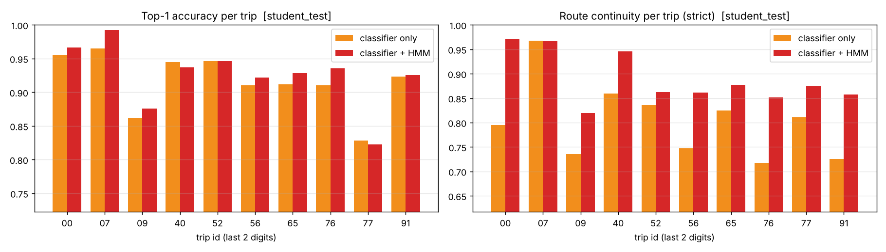{width=100%}

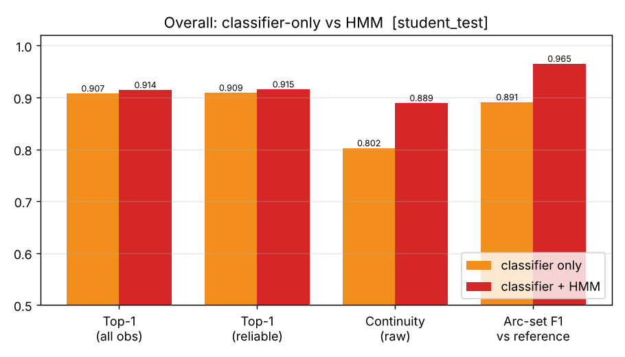{width=62%}

---

## 6. Geographical visualisation using Folium

`scripts/08_make_maps.py` (via `src/pathsnap/viz/folium_maps.py`) writes `maps/hmm_student_test_<trip>.html` for the best, median and worst student-test trip. Layers, each in its own colour and toggleable in a layer control with a legend: raw GPS fixes (blue dots, sub-sampled for size, start/end markers), road network near the trip (grey), reference route (green, wide), classifier-only route (orange) and HMM/Viterbi route (red); the map is fitted to the trip's extent, and the title carries the trip's classifier-only and HMM Top-1.

{width=100%}

---

## 7. API, UI and deployment

* **API (laptop 1)** — `api/main.py`, FastAPI: `GET /health`, `GET /trips` (ids and fix counts of the evaluation folder; no labels), `POST /predict` (loads `.track/.nodes/.arcs` only → `pathsnap.pipeline.predict_trip`: projection → candidates → features → scaler → tuned LightGBM → HMM → stitched route). After prediction, `api/evaluator.py` — the only runtime module allowed to read `.route` — scores the result with the same definitions as this report (per-observation Top-1 for HMM and classifier-only, continuity, sequence F1, candidate miss rate). Each request is logged on the laptop-1 console with stage timings and accuracy. Artifacts loaded at start-up: `artifacts/model.joblib`, `scaler.joblib`, `features.json`, `candidate_config.json`, `threshold.json`, `hmm_config.json`, `manifest.json`.
* **UI (laptop 2)** — `ui/app.py`, Streamlit: API address field and health indicator, trip picker, layer toggles, live Folium map (GPS, HMM route, classifier route), metrics and per-stage timings.
* **Run:** laptop 1 `uvicorn api.main:app --host 0.0.0.0 --port 8000` with `PATHSNAP_EVAL_DIR` set to the evaluation folder; laptop 2 `streamlit run ui/app.py` with `PATHSNAP_API_URL=http://<laptop-1-ip>:8000` (full steps in `README.md`).

{width=100%}

{width=88%}

{width=80%}

![Figure 7.4 — Command prompt of laptop 1, the machine running the API (`uvicorn api.main:app --host 0.0.0.0 --port 8000`): the model bundle loads (manifest: `lightgbm_tuned`, 37 features, τ = 0.45), then the evaluator UI's `GET /health`, `GET /trips` and `POST /predict` calls all return `200 OK`. The `/predict` request for student_test trip 00000000 reports HMM Top-1 96.64 % and sequence F1 0.9650, matching `results/hmm/comparison.csv`. In this session the UI ran on the same laptop (client 127.0.0.1); figure 7.1 shows the UI on laptop 2 reaching this API over the network.](screenshots/api_console_laptop1.png){width=100%}

**API console on the receiving laptop.** Every `/predict` call is logged by the API process; the full console output of the screenshot session is committed as `report/screenshots/api_console_log.txt` (9 `/predict` requests, all `200 OK`). Excerpt (timings shortened, otherwise verbatim):

```
2026-11-18 17:58:56,987 [INFO] Loaded bundle from artifacts (manifest: {'model_tag': 'lightgbm_tuned', 'model_file': 'model.joblib', 'model_class': 'LightGBMModel', ...})
INFO:     Application startup complete.
==================================================
PathSnap Request: Trip=00000076 | Client=127.0.0.1
Timings: {'load': 23.1, 'candidates': 262.9, 'features': 157.9, 'model': 614.8, 'hmm': 1312.4, 'route': 110.0, 'total': 3352.06, 'scoring': 827.74}
Top-1 Accuracy: 93.54% | Sequence F1: 0.9492
Status: 200 OK | Duration: 3410.4ms
==================================================
INFO:     127.0.0.1:38590 - "POST /predict HTTP/1.1" 200 OK
==================================================
PathSnap Request: Trip=00000007 | Client=127.0.0.1
Timings: {'load': 2.0, 'candidates': 65.4, 'features': 62.0, 'model': 168.5, 'hmm': 276.9, 'route': 2.6, 'total': 945.75, 'scoring': 262.09}
Top-1 Accuracy: 99.26% | Sequence F1: 0.9798
Status: 200 OK | Duration: 946.6ms
==================================================
INFO:     127.0.0.1:38590 - "POST /predict HTTP/1.1" 200 OK
```

During the evaluation the same console is shown live on laptop 1 while the evaluator drives the UI on laptop 2.

---

## 8. Academic integrity and AI-assistance disclosure

All experiments use only the provided train and student_test partitions; every number in this report is read from a result file in the repository and can be regenerated with the commands in `README.md`. Data processing, model training and the Bayesian optimisation were run by team members on their own laptops; the EDA figures were produced by M1's run of `scripts/01_eda.py` (later re-saved by the AI assistant with a figure-cropping fix, data unchanged); the decoder tuning and HMM evaluation (scripts 06–07) were run by the team on M1's laptop (the committed `results/hmm/` files come from that run; the AI assistant had reproduced the same results independently). The evaluator partition was never accessed during development, and the prediction path cannot read routes or labels (enforced by `tests/test_no_label_leak.py`).

**AI assistance.** We used Claude (Anthropic) as a coding and writing assistant during the event: planning the work split; drafting code for data loading, projection, label alignment, candidate generation and features (M1), the shared training/metrics/Bayesian-optimisation scripts (M2), the efficient implementation of M3's HMM design and the decoder tuning/evaluation scripts, the corrected API scoring (M4), adapting M4's MLP to the shared cross-validation protocol (the MLP run itself was done on M1's laptop); and drafting this report from our result files. The screenshots of the running system (figures 2.6, 6.1, 7.2, 7.3) were captured with the Antigravity browser agent on M1's laptop; figure 7.1 was taken by hand on laptop 2. The team chose the models and parameters from the recorded evidence, reviewed the code and is responsible for every claim here; the itemised log, including which runs the assistant executed, is in `docs/AI_DISCLOSURE.md`.

---

## Appendix — reproducing every result

```
python scripts/00_inventory.py                      # inventory / data quality  -> results/eda
python scripts/02a_candidate_sweep.py               # K / radius evidence       -> results/data/candidate_sweep.csv
python scripts/02_build_dataset.py                  # labels, candidates, features, folds, scaler
python scripts/01_eda.py                            # EDA figures + Folium EDA maps
python scripts/03_train_model.py --model logreg     # likewise knn, rf, extratrees, lightgbm
python scripts/04_compare_models.py --tags logreg knn rf extratrees lightgbm lightgbm_tuned
python scripts/05_bayes_opt.py --model lightgbm     # 40-trial TPE search + tuned refit
python scripts/09_export_artifacts.py --tag lightgbm_tuned
python scripts/06_tune_decoder.py --model lightgbm_tuned
python scripts/07_eval_hmm.py --model lightgbm_tuned
python scripts/08_make_maps.py --model lightgbm_tuned
```
